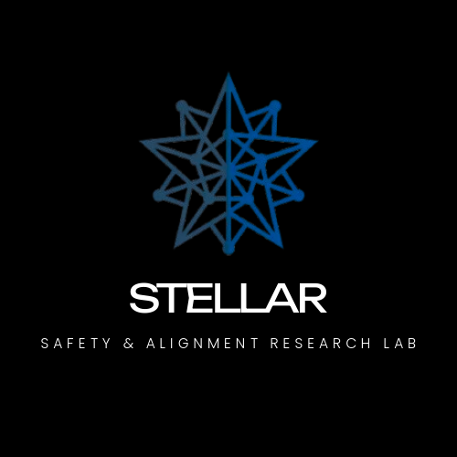

<div align="center">



# StellarLab
### Stellar Safety & Alignment Research Lab (Stellar SAR Lab)

[](https://pradeep-016.github.io/stellar-sar-lab/)
[-10b981?style=for-the-badge)](https://pradeep-016.github.io/stellar-sar-lab/#/publications)
[](https://huggingface.co/StellarLab)
[](LICENSE)

*An independent empirical research initiative investigating learned objectives, reward modeling, and evaluator reliability under optimization pressure.*

</div>

---

## 🔬 Scientific Mission

Modern frontier artificial intelligence relies heavily on learned reward models, process verifiers (PRMs), and automated judges to steer reinforcement learning and inference-time search.

**StellarLab** investigates the reliability, calibration boundaries, and failure modes of these evaluators under increasing optimization pressure. Our central empirical question is:

> **"How reliable are the objectives and evaluators used to guide increasingly capable AI systems, particularly under optimization pressure?"**

---

## 🧭 Core Research Directions

1. **Evaluator Reliability:** Investigating whether learned reward models reliably distinguish genuinely high-quality completions from outputs that merely receive inflated proxy scores under candidate selection.
2. **Reward Hacking & Specification Gaming:** Analyzing how optimization systems exploit weaknesses, loopholes, and unintended incentives in learned reward functions.
3. **Reward Modeling:** Advancing multi-dimensional preference learning, dimension-level supervision, and generalization bounds (e.g., Associative Reward Model).
4. **Reward–Quality Divergence:** Measuring the empirical decoupling of proxy evaluator scores from verifiable task correctness (Goodhart's Law in alignment).
5. **Test-Time Scaling & Inference Optimization:** Probing the boundaries of Best-of-N selection across candidate budgets up to $N = 256$.
6. **AI Safety & Empirical Alignment:** Auditing the robustness, generalization, and auditability of preference-guided language models.

---

## 📂 Featured Research Projects

### 01. Evaluator Reliability in Language Models Under Test-Time Scaling
* **Status:** Accepted for poster presentation at the **AIAS 2026 Workshop on Lifelong Agents: Learning, Aligning, and Evolving (LLA)**.
* **Scope:** Systematic evaluation across GSM8K mathematical reasoning and HumanEval code generation, testing three candidate generators and multiple learned verifiers up to selection budgets $N = 256$.
* **Key Empirical Observation:** Under DeepSeek PRM selection, Llama 3.1 8B Instruct achieved **80.4% observed accuracy at $N = 8$**, but declined to **72.2% observed accuracy at $N = 256$** on GSM8K reasoning—despite expanding proxy reward margins.
* **Integrity Guarantee:** Result is reported strictly within its experimental boundaries without claiming universal causal mechanisms or interpolating unmeasured intermediate points.

### 02. Associative Reward Model (ARM)
* **Status:** In Progress / Standalone merged model release upon publication.
* **Architecture:** Foundation on **Qwen3-8B**, trained with 4-bit NF4 quantization using **QLoRA** on dual NVIDIA T4 GPUs over 7,500 curated preference pairs.
* **Supervision:** Decomposes evaluation across six explicit dimensions:
  1. *Instruction Adherence*
  2. *Relevance*
  3. *Completeness*
  4. *Reasoning Validity*
  5. *Task Correctness*
  6. *Communication Quality*
* **Reported Benchmark Evaluations:**
  * RewardBench Evaluation 1: **89.2**
  * RewardBench Evaluation 2: **74.4**
  * RM-Bench (Hard Style-Trap): **65.6**
  * JudgeBench: **62.5**
* **Release Format:** Merged standalone model weights (not an adapter-only release).

---

## 💻 Tech Stack & Architecture

* **Core Framework:** React 18 / Vite / TypeScript
* **Styling & Design Tokens:** Tailwind CSS / CSS Custom Properties
* **Interactive Visualizations:**
  * Custom Three.js / Canvas 2D/3D Particle Constellation Hero
  * Interactive Goodhart Reward–Quality Divergence Explanatory Curve
  * Interactive Best-of-N Candidate Selection Simulator
  * Interactive ARM 6-Dimension Architecture & Loss Inspector
  * Verified Empirical Observation Chart (GSM8K $N=8$ vs $N=256$)
* **Routing:** HashRouter (100% SPA routing reliability on GitHub Pages static hosting)
* **Icons:** Lucide React

---

## 🚀 Local Development

```bash
# Clone repository
git clone https://github.com/pradeep-016/stellar-sar-lab.git
cd stellar-sar-lab

# Install dependencies
npm install

# Start local development server
npm run dev

# Build production bundle
npm run build

# Preview production build locally
npm run preview
```

---

## 🌐 GitHub Pages Deployment

This repository includes a continuous deployment workflow configured in [`.github/workflows/deploy.yml`](.github/workflows/deploy.yml).

On push to `main`:
1. Installs dependencies and builds the production bundle into `dist/`.
2. Automatically deploys to GitHub Pages at:
   **`https://pradeep-016.github.io/stellar-sar-lab/`**

---

## 🤝 Contact & Collaboration

For research inquiries, empirical replication discussions, and academic correspondence:

* **Email:** [pradeep02272002@gmail.com](mailto:pradeep02272002@gmail.com)
* **GitHub:** [https://github.com/pradeep-016/stellar-sar-lab](https://github.com/pradeep-016/stellar-sar-lab)
* **Hugging Face:** [https://huggingface.co/StellarLab](https://huggingface.co/StellarLab)

---

<div align="center">
<sub>© 2026 Stellar Safety & Alignment Research Lab (Stellar SAR Lab). Independent empirical research initiative.</sub>
</div>
