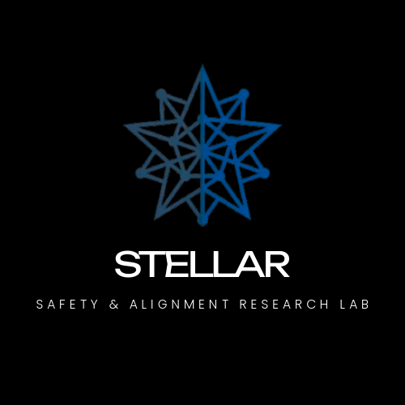

<div align="center">



# Stellar ASION

[](https://pradeep-016.github.io/stellar-sar-lab/)
[-0284c7?style=for-the-badge)](https://pradeep-016.github.io/stellar-sar-lab/#/projects)
[](https://huggingface.co/Stellar-lab)
[](LICENSE)

*An independent empirical AI safety initiative investigating learned objectives, reward modeling, and evaluator reliability under optimization pressure.*

</div>

---

## 🔬 Scientific Mission & Institutional Identity

**Stellar ASION** is an independent empirical research initiative investigating AI safety and alignment.

Our core scientific investigation examines how reliable objectives, reward models, and evaluators remain when subjected to optimization pressure:

> **"How reliable are the objectives and evaluators used to guide increasingly capable AI systems, particularly under optimization pressure?"**

*Note on Institutional Scope:* Stellar ASION operates as an independent empirical research initiative. Its official research journey begins with the Associative Reward Model (ARM). Previous independent research projects and publications by the researcher were conducted under personal research activities and are strictly separated from Stellar ASION's research portfolio.

---

## 🧭 Laboratory Research Pillars

Stellar ASION focuses on empirical AI Safety and Alignment across three consolidated pillars:

1. **Evaluator Reliability & Search Dynamics:** Investigating Goodhart divergence, verifier degradation, and error amplification across test-time search compute budgets.
2. **Decomposed Preference Supervision (ARM):** Advancing multi-dimensional reward architectures to disentangle stylistic markers, verbosity, and surface flattery from factual validity.
3. **Scalable Oversight & Reasoning Faithfulness:** Mitigating sycophancy, post-hoc chain-of-thought rationalization, and evaluator flattery in autonomous models.

---

## 📂 Founding Research Project: Associative Reward Model (ARM)

The **Associative Reward Model (ARM)** is the founding research project undertaken under Stellar ASION.

* **Designation:** Stellar ASION Founding Research Project
* **Status:** In Progress / Model checkpoint available upon publication.
* **Architecture:** Foundation backbone on **Qwen3-8B**, trained with 4-bit NormalFloat (NF4) quantization using **QLoRA** on dual NVIDIA T4 GPUs over 7,500 curated preference pairs.
* **Core Hypothesis:** Collapsing complex preference signals into an uninterpretable scalar score creates susceptibility to style traps and single-axis gaming. By decomposing evaluation across six explicit dimensions with consistency regularization, ARM isolates genuine task execution from superficial artifacts.
* **Supervision Dimensions:**
  1. *Instruction Adherence:* Strict conformance to prompt constraints and formatting directives.
  2. *Relevance:* Direct pertinence to user intent without extraneous digressions.
  3. *Completeness:* Exhaustive coverage of all specified query requirements.
  4. *Reasoning Validity:* Logical, mathematical, and deductive soundness across the chain of thought.
  5. *Task Correctness:* Domain-grounded accuracy and factual correctness of solutions.
  6. *Communication Quality:* Coherence, clarity, and structural readability.
* **Reported Benchmark Evaluations:**
  * AllenAI RewardBench 1: **89.08%** Subset Macro-Average (85.52% 50/50 Math+Code weighted; Chat: 92.36%, Safety: 90.21%, Reasoning: 90.54%)
  * AllenAI RewardBench 2: **74.20%** Overall Macro-Average (Factuality: 66.95%, Math: 65.03%, Safety: 93.33%, Focus: 96.97%)
  * THU-KEG RM-Bench: **74.88%** Overall Average (Easy: 82.69%, Normal: 76.44%, Hard Style-Trap: 65.51%)
  * ScalerLab JudgeBench: **62.50%** Overall Micro-Average (GPT-4o Split: 63.71%, Claude-3.5 Split: 60.93%; Math: 74.11%, Coding: 65.07%)
* **Artifact Release:** Open model checkpoint on Hugging Face.

---

## 📄 Publications & Research Outputs

* **Peer-Reviewed Workshop Acceptance:**
  * *Evaluator Reliability Under Test-Time Scaling*
  * Accepted Workshop Paper at **AIAS 2026 Workshop on Lifelong Agents (held in conjunction with LLA 2026)**.
  * Authors: Pradeep L.

* **Working Manuscript:**
  * *Associative Reward Model (ARM): Multi-Dimensional Preference Supervision in Language Models*
  * Technical Report (In Preparation).
  * Authors: Pradeep L.

---

## 💻 Tech Stack & Web Architecture

* **Core Framework:** React 18 / Vite / TypeScript
* **Styling & Design Tokens:** Tailwind CSS / CSS Custom Properties
* **Interactive Tools:**
  * Interactive Three.js / Canvas 2D/3D Constellation Hero Network
  * Interactive Best-of-N Candidate Selection Simulator
  * Interactive ARM Architecture & Loss Inspector
* **Routing:** HashRouter (100% SPA routing reliability on GitHub Pages static hosting)
* **Icons:** Lucide React

---

## 🚀 Local Development

```bash
# Clone repository
git clone https://github.com/pradeep-016/stellar-sar-lab.git
cd stellar-sar-lab

# Install dependencies
npm install

# Start local development server
npm run dev

# Build production bundle
npm run build

# Preview production build locally
npm run preview
```

---

## 🌐 GitHub Pages Deployment

This repository includes continuous deployment configured in [`.github/workflows/deploy.yml`](.github/workflows/deploy.yml).

On push to `main`:
1. Installs dependencies and builds the production bundle into `dist/`.
2. Automatically deploys to GitHub Pages at:
   **`https://pradeep-016.github.io/stellar-sar-lab/`**

---

## 🤝 Contact & Channels

For research correspondence, collaboration, and inquiries:

* **Research Email:** [pradeep.ai.research@zohomail.in](mailto:pradeep.ai.research@zohomail.in)
* **GitHub Repository:** [https://github.com/pradeep-016/stellar-sar-lab](https://github.com/pradeep-016/stellar-sar-lab)
* **Hugging Face Organization:** [https://huggingface.co/Stellar-lab](https://huggingface.co/Stellar-lab)
* **Researcher Profile (Pradeep L):** [https://huggingface.co/Pradeep016](https://huggingface.co/Pradeep016)

---

<div align="center">
<sub>© 2026 Stellar ASION. Independent empirical research initiative.</sub>
</div>
